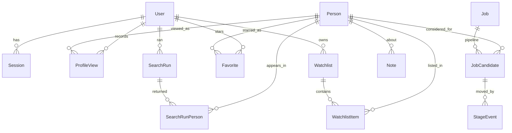

# HR Sourcing Dashboard — Redesign Design

Date: 2026-09-02
Status: Approved

## Problem

The dashboard works end to end but is hard to use, and it is missing the
capabilities an HR team needs:

1. No breakdown or filtering by country, region, location, education, field of
   study, experience, industry, or language level.
2. Scoring produces false positives, so results are hard to trust.
3. Every search inserts fresh candidate rows, so the same person appears as many
   unrelated records. There is no search history and no deduplication.
4. No record of which candidates have already been looked at.
5. No way for several HR people to work the same candidate pool without
   colliding — no shared "already seen", no pipeline phase, no watchlists.

The current app is a single-user prototype: no `User` model, no login, one
long-scrolling filter column, and a flat rule-based score.

## Decisions

These were settled with the user before design and are fixed inputs:

| Decision | Choice |
|---|---|
| Primary complaint | The dashboard is hard to *use* |
| Screen layout | Folded filter rail on the left, candidate list fills the rest, results-first |
| The ten dimensions | Clickable facet counts — see the pool shape and narrow it in one click |
| Gender and nationality | **Not built.** Replaced by country of residence, work authorisation, and language proficiency |
| Deployment | One shared server; each HR person opens a URL |
| Identity | Email + password login, accounts created by an admin |
| Pipeline phase | Scoped per job being hired for, not per candidate and not per watchlist |
| Duplicates | Kept and flagged ("seen in 2 earlier searches"), never hidden by default |
| Accuracy approach | Fix and extend the rules with visible reasons. No AI ranking layer for now |
| Watchlists | Favourites private per user; watchlists created private, shareable to the team |

### Why gender and nationality are excluded

Screening on either is prohibited under US EEOC rules, EU equal-treatment
directives, and comparable GCC labour regulations, and a stored search recording
such a filter is written evidence of it. Neither field exists in LinkedIn data,
so offering them would require inferring from names and photos — least accurate
for Arabic, Chinese, and unisex names, which works directly against goal 2.
Country of residence and work authorisation cover the underlying hiring need.

## Assumptions

- A profile view is recorded automatically the first time a given user opens a
  person's detail panel. There is no "mark as seen" button.
- The database stays SQLite in WAL mode as a file on the shared server. This
  supports a team of roughly ten concurrent HR users. Moving to Postgres is an
  adapter swap in `src/lib/prisma.ts` and requires no model changes.
- Work authorisation is entered by HR. It is not present in scraped data and is
  never inferred.
- Scraping stays behind `APIFY_MOCK` for development. Nothing in this design
  depends on live scraping.

## Build order

Each phase is independently shippable and leaves the app working.

| Phase | Delivers | Addresses |
|---|---|---|
| 1 — Foundation | Users, login, one permanent record per profile, normalisation layer, test suite | groundwork for 1, 3, 4, 5 |
| 2 — New screen | Filter rail layout, facet counts on every dimension | 1 |
| 3 — Accuracy | Rewritten scoring, must-haves as gates, "why this score" panel | 2 |
| 4 — Teamwork | Jobs, phase pills with history, seen-by markers, watchlists, favourites | 4, 5 |
| 5 — History | Past-searches screen, re-run a search, repeat flagging surfaced | 3 |

## Architecture

### The central data change

`Candidate` today is one row per person *per search run*. It becomes:

- `Person` — one permanent row per LinkedIn profile URL, unique on `profileUrl`.
  Holds the profile plus every normalised dimension.
- `SearchRunPerson` — the join between a search run and a person, holding that
  run's score and breakdown, and whether the person was already known.

This one change is what makes deduplication, history, seen-by markers, and
per-job phases all possible. It also means an already-scraped profile is not
re-fetched, which saves Apify credits.

### Data model

New models: `User`, `Session`, `Person`, `SearchRunPerson`, `Job`,
`JobCandidate`, `StageEvent`, `ProfileView`, `Watchlist`, `WatchlistItem`,
`Favorite`. `Note` and `SavedSearch` gain an owner. `SearchRun` gains an owner
and a name.

Key constraints:

- `Person.profileUrl` unique — the deduplication key.
- `JobCandidate` unique on `(jobId, personId)` — one phase per person per job.
- `ProfileView` unique on `(personId, userId)`, with a view count and timestamps.
- `Favorite` unique on `(userId, personId)`.
- `StageEvent` is append-only: who moved whom, from which phase to which, when.

SQLite has no enum type, so `User.role`, `JobCandidate.stage`, and
`SearchRun.status` stay strings, validated at the application boundary by Zod
schemas rather than by the database.

### Normalisation layer

A new `src/lib/normalize/` module, one small file per dimension, each a pure
function that is unit-testable in isolation:

| File | Input | Output |
|---|---|---|
| `location.ts` | `"San Francisco, CA"` | `{ city, country, region }` |
| `regions.ts` | country | region (GCC, MENA, Europe, …) lookup table |
| `education.ts` | `education[]` | highest degree level, fields of study |
| `experience.ts` | `experience[]` | total years, overlapping roles de-duplicated |
| `languages.ts` | raw languages | `{ name, level }` where level is present |
| `industry.ts` | profile industry, else company | normalised industry |

Three of these dimensions are already present in scraped payloads but discarded
by `mapToCandidate` in `src/lib/apify.ts`: `education[].field`, language
proficiency, and profile `industry`. The mapper is corrected as part of Phase 1.

`totalYearsExperience` is frequently absent from scraped data. Rather than
trusting it, `experience.ts` computes years from `experience[].durationMonths`,
merging overlapping date ranges so concurrent roles are not double-counted.

### Authentication

- Email plus password. Passwords hashed with scrypt via `node:crypto` — no new
  dependency, and it is a memory-hard KDF suitable for password storage.
- Server-side sessions in the `Session` table, referenced by an httpOnly,
  sameSite=lax, secure-when-HTTPS cookie. Chosen over JWTs so an admin can
  revoke a session immediately.
- Two roles: `ADMIN` (manages users) and `RECRUITER`.
- All routes except `/login` and the login API require a session. Enforced in one
  place — a `requireUser()` helper used by every route handler and server
  component — rather than scattered checks.
- The first run seeds one admin account from `SEED_ADMIN_EMAIL` and
  `SEED_ADMIN_PASSWORD`, and forces a password change on first login.

### Scoring (designed now, built in Phase 3)

`src/lib/scoring.ts` is replaced by `src/lib/scoring/`:

- `matching.ts` — exact-token matching with an alias table, replacing substring
  `includes`. Fixes `Java` matching `JavaScript` and `R` matching everything.
- `weights.ts` — every weight in one place, tunable per search.
- `rules/` — one file per dimension: skills, titles, seniority, location,
  education, languages, industry, exclusions.
- `gates.ts` — hard requirements, separated from soft scoring. A missing
  must-have skill or a hit on an excluded keyword removes a candidate from the
  result set instead of costing a handful of points.
- Every awarded or deducted point carries its evidence, which is what the "why
  this score" panel renders.

### UI structure (Phase 2 onward)

| Route | Purpose |
|---|---|
| `/login` | Sign in |
| `/` | Search workspace — filter rail plus candidate list |
| `/searches` | Search history, re-run a past search |
| `/jobs/[id]` | Pipeline board, candidates grouped by phase |
| `/watchlists/[id]` | A watchlist |
| `/admin/users` | Account management, admin only |

`src/components/SearchBuilder.tsx` is 293 lines holding filter state, boolean
query preview, and results together. Phase 2 splits it into `FilterRail`,
`FacetGroup`, `ResultsList`, `CandidateRow`, and `CandidateDrawer`, each with one
responsibility.

## Phase 1 scope

Phase 1 is the foundation. It deliberately changes very little that is visible —
a login page — while replacing what everything else stands on.

In scope:

1. Vitest set up with unit tests for `normalize/`, `buildBooleanQuery`, and the
   Apify mapper.
2. The full Prisma schema above, with a migration that carries existing
   `Candidate` rows into `Person` plus `SearchRunPerson`, collapsing duplicates
   by `profileUrl` and keeping the most recently scraped version of each.
3. The `src/lib/normalize/` module.
4. `mapToCandidate` corrected to stop discarding field of study, language
   proficiency, and industry.
5. Authentication: `User`, `Session`, scrypt hashing, `requireUser()`, the login
   and logout routes, the `/login` page, admin seeding including the forced
   password change on the seeded admin's first login, and `/admin/users`.
6. The search pipeline rewired to upsert `Person` by `profileUrl` and record
   `SearchRunPerson`, so a re-found profile is not re-scraped.
7. Existing API routes brought behind authentication and given an owner.

Out of scope for Phase 1, by design: the new layout, facet counts, the scoring
rewrite, jobs, phases, seen-by markers, watchlists, and the history screen. Each
has its own phase.

## Error handling

- Scraper failures already set `SearchRun.status`. Phase 1 adds the failure
  reason to the record and surfaces it, rather than leaving a run stuck at
  `RUNNING`.
- Normalisation never throws. An unparseable location yields
  `{ city: null, country: null, region: null }` and the raw string is preserved,
  so a person is never lost to a parsing failure.
- A `Person` upsert conflict on `profileUrl` resolves to an update, so two
  concurrent searches finding the same person cannot produce a duplicate.
- Auth failures return a single generic message for both unknown email and wrong
  password, so the login form cannot be used to enumerate accounts.

## Testing

There is no test suite today. Phase 1 introduces Vitest, targeting the pure
logic where bugs are cheapest to catch:

- `normalize/*` — one test file per dimension, including messy real-world
  locations, missing education fields, and overlapping employment dates.
- `apify.mapToCandidate` — that field of study, language level, and industry
  survive the mapping.
- `buildBooleanQuery` — existing behaviour locked in before it is extended.
- Auth — password hash round-trip, session expiry, and that `requireUser()`
  rejects a missing, expired, and tampered cookie.
- The `Candidate` to `Person` migration — that duplicates collapse and no person
  is lost.

Each is written before the implementation it covers.

## Risks

- The migration is the one irreversible step. It runs against a committed
  baseline, is tested on a copy of `dev.db` first, and the existing data is mock
  candidates, so the cost of an error is low.
- SQLite write contention under concurrent HR use is unlikely at ten users with
  WAL enabled, but it is the first thing to check if the shared server feels
  slow. The mitigation is already designed: swap the adapter for Postgres.
